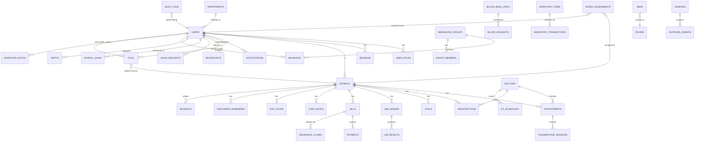

# ARCH.md — Hospital Management System: Application Flow & Data-Trace Map

> **Single source of truth** for how the Hospital Management System (HMS) works: startup, auth, roles & permissions, every API route, every frontend route, data flows, jobs, notifications, files, external integrations, and the known architecture risks.
>
> **Documentation rule:** everything in this file is derived from the actual source code in this repository. Where a claim could only be confirmed by running the system (not by reading code), it is marked **`⚠️ UNVERIFIED — requires runtime verification`**.
>
> **Last verified against code:** 2026-08-08. Relative links point to `server/` and `client/` at the repository root.

---

## Table of Contents

1. [System Overview](#1-system-overview)
2. [Tech Stack & Infrastructure](#2-tech-stack--infrastructure)
3. [Repository Layout](#3-repository-layout)
4. [Application Startup & Boot Sequence](#4-application-startup--boot-sequence)
5. [Configuration & Environment Variables](#5-configuration--environment-variables)
6. [Entry Flow — Request Lifecycle](#6-entry-flow--request-lifecycle)
7. [Login Flow](#7-login-flow)
8. [Session Refresh & Logout Flow](#8-session-refresh--logout-flow)
9. [Two-Factor Authentication (2FA) Flow](#9-two-factor-authentication-2fa-flow)
10. [Authentication & Authorization Data Flow](#10-authentication--authorization-data-flow)
11. [Role & Permission Model](#11-role--permission-model)
12. [Role → API Access Map](#12-role--api-access-map)
13. [Role → Frontend Routing Map](#13-role--frontend-routing-map)
14. [Database Layer & Data Flow](#14-database-layer--data-flow)
15. [Module CRUD Map](#15-module-crud-map)
16. [File Upload / Download / Storage Flow](#16-file-upload--download--storage-flow)
17. [External Service Integrations](#17-external-service-integrations)
18. [Job Queue Flow (BullMQ)](#18-job-queue-flow-bullmq)
19. [Notification Flow (DB + Socket.io + WebPush)](#19-notification-flow-db--socketio--webpush)
20. [Audit Logging Flow](#20-audit-logging-flow)
21. [Error Handling & Logging Flow](#21-error-handling--logging-flow)
22. [Frontend State Management & API Client](#22-frontend-state-management--api-client)
23. [Real-Time / WebSocket Flows](#23-real-time--websocket-flows)
24. [User Journeys](#24-user-journeys)
25. [Entity-Relationship Diagram (Mermaid)](#25-entity-relationship-diagram-mermaid)
26. [Master Architecture Diagram (Mermaid)](#26-master-architecture-diagram-mermaid)
27. [File-Level Traceability](#27-file-level-traceability)
28. [Unknown / Unverified Behaviour](#28-unknown--unverified-behaviour)
29. [Architecture Risks](#29-architecture-risks)

---

## 1. System Overview

The HMS is a full-stack, role-based hospital management application:

- **Server:** Node.js (ESM) + Express 4 + Socket.io + BullMQ, talking to PostgreSQL (via `pg`), Redis, SMTP, ClamAV, Razorpay, OpenFDA, and (optionally) a generative-AI provider for the patient chatbot.
- **Client:** React 18 + Vite + React Router v7-flavoured config + TanStack Query + Zustand + Axios, with a Workbox-based Service Worker registered **in production only**.
- **Scope:** 33 REST API modules, ~265 route definitions, 19 roles, 8 user-facing frontend dashboard groups, real-time messaging/telemedicine/notifications, background jobs, and a tamper-evident audit log.

Scale facts (measured from source):
- Server source files: ~170 under `server/src`.
- Client source files: ~206 under `client/src`.
- Database migrations: 19 (`server/src/db/migrations/001…019`).
- Test files: 39 under `server/tests`.

---

## 2. Tech Stack & Infrastructure

### Runtime / frameworks

| Concern | Technology | Where |
|---|---|---|
| Server runtime | Node.js, ESM, `import 'dotenv/config'` | [server/package.json](./server/package.json) |
| HTTP framework | Express 4 (`express@^4`) | [server/src/app.js](./server/src/app.js) |
| Real-time | Socket.io (`socket.io@^4`) | [server/src/socket.js](./server/src/socket.js) |
| Jobs | BullMQ (`bullmq@^5`) | [server/src/shared/jobs/queue.js](./server/src/shared/jobs/queue.js) |
| ORM / DB | `pg` (raw SQL, no ORM) | [server/src/shared/db/pool.js](./server/src/shared/db/pool.js) |
| Validation | Zod (`zod@^3`) | e.g. [admin.schema.js](./server/src/modules/admin/admin.schema.js) |
| Passwords | Argon2 (`argon2`) | [auth.service.js](./server/src/modules/auth/auth.service.js) |
| JWT | `jsonwebtoken` (RS256) | [auth.service.js](./server/src/modules/auth/auth.service.js) |
| CSRF | `csrf-csrf` (double-submit) | [app.js](./server/src/app.js) |
| File virus scan | `clamscan` (TCP clamd) | [file.service.js](./server/src/modules/files/file.service.js) |
| PDF | Puppeteer | [pdf.service.js](./server/src/shared/utils/pdf.service.js) |
| Email | Nodemailer + SMTP (MailHog in dev) | [mailer.js](./server/src/shared/services/mailer.js) |
| Push | `web-push` (VAPID) | [webpush.service.js](./server/src/shared/services/webpush.service.js) |
| Payments | Razorpay (REST SDK-less, signature verify) | [billing.service.js](./server/src/modules/billing/billing.service.js) |
| Payload encryption | AES-GCM (client ↔ server), `PGP_SYM_ENCRYPT` (at rest) | [sessionKey.js](./client/src/shared/utils/sessionKey.js), [pgcrypto.js](./server/src/shared/db/pgcrypto.js) |

### Client frameworks

| Concern | Technology | Where |
|---|---|---|
| UI | React 18 + JSX | [client/src/App.jsx](./client/src/App.jsx) |
| Build | Vite | [client/vite.config.js](./client/vite.config.js) |
| Routing | React Router (`react-router-dom`) | [client/src/App.jsx](./client/src/App.jsx) |
| Server state | TanStack Query | [client/src/App.jsx](./client/src/App.jsx) |
| Client state | Zustand | [client/src/shared/store/index.js](./client/src/shared/store/index.js) |
| HTTP | Axios | [client/src/shared/utils/api.js](./client/src/shared/utils/api.js) |
| Service Worker | Workbox (`workbox-window`) — **prod only** | [client/src/main.jsx](./client/src/main.jsx), [client/src/sw.js](./client/src/sw.js) |

### Infrastructure (docker-compose)

| Service | Image | Port (host) | Purpose |
|---|---|---|---|
| PostgreSQL | `postgres:16-alpine` | `5555` → 5432 | Primary DB. Vol `postgres_data` |
| Redis | `redis:7-alpine` | `6379` | Sessions/refresh tokens, OTP, rate limits, BullMQ, caches |
| ClamAV | `clamav/clamav:stable` | `3310` | Virus scanning of uploads. Vol `clamav_db` |
| MailHog | `mailhog/mailhog` | `1025` (SMTP), `8025` (UI) | Dev email capture |

[Docker compose file](./docker-compose.yml) · [setup-roles.js](./server/src/db/setup-roles.js)

---

## 3. Repository Layout

```
E:\hospital management system\
├── ARCH.md                  ← this file
├── SECURITY.md              ← security model / hardening notes
├── WORKER_CREDENTIALS.md    ← job-worker credential notes
├── API_ROUTES.md            ← existing (incomplete) route reference
├── docker-compose.yml       ← Postgres/Redis/ClamAV/MailHog stack
├── .gitignore
├── server/
│   ├── package.json
│   ├── vitest.config.js
│   ├── .env / .env.example  ← runtime secrets & config
│   ├── keys/                ← RS256 JWT keypair (gitignored)
│   ├── src/
│   │   ├── app.js           ← Express bootstrap, middleware order, routes, errors
│   │   ├── socket.js        ← Socket.io bootstrap + JWT middleware
│   │   ├── modules/<name>/  ← 33 modules (routes/controller/service/schema/socket)
│   │   ├── shared/
│   │   │   ├── middleware/  ← auth, rbac(authorize), ownership, validate, ipBlock, rateLimiter, audit
│   │   │   ├── db/          ← pool.js, pgcrypto.js
│   │   │   ├── jobs/        ← queue, worker-handlers, workerConfig, midnightFlush
│   │   │   ├── services/    ← redis, email/mailer, notification, webpush, ...
│   │   │   └── utils/       ← pdf, corsOriginCheck, uuid, logger
│   │   └── db/              ← schema.sql, migrations/001..019, setup-roles, migrate, seed
│   └── tests/               ← 39 Vitest test files
└── client/
    ├── package.json
    ├── vite.config.js
    ├── index.html
    └── src/
        ├── main.jsx         ← React root, theme init, SW registration (prod)
        ├── App.jsx          ← Router, role guards, lazy pages
        ├── sw.js            ← Workbox service worker (prod only)
        ├── modules/<domain>/← dashboards, forms, views
        └── shared/          ← store, utils (api, sessionKey), components
```

---

## 4. Application Startup & Boot Sequence

### Server boot (`server/src/app.js`)

```
1. import 'dotenv/config'                                  app.js:1
2. Validate REQUIRED_ENV — exit(1) if any missing          app.js:57-68
   (DB_HOST, DB_NAME, DB_USER, DB_PASSWORD,
    JWT_PRIVATE_KEY_PATH, JWT_PUBLIC_KEY_PATH,
    PG_CRYPTO_KEY, DB_ENCRYPTION_KEY, CSRF_SECRET)
3. Create express app                                      app.js:70
4. Set trust proxy (loopback dev / hop count prod)         app.js:75-78
5. Mount middleware chain in order (see §6)                app.js:81-183
6. Mount 33 route modules under /api/*                     app.js:185-220
7. /health endpoint                                        app.js:223
8. Global error handler                                    app.js:227-239
9. createServer + initSocket(httpServer)                   app.js:242-243
10. app.set('io', io)  (routes use req.app.get('io'))      app.js:246
11. httpServer.listen(PORT)  (default 5000)                app.js:248-251
12. Graceful shutdown on SIGTERM/SIGINT:                   app.js:253-300
    close HTTP → close BullMQ queues → pool.end() → redis.quit()
13. unhandledRejection / uncaughtException handlers        app.js:305-310
    (log + continue, never crash the process)
```

### Client boot (`client/src/main.jsx`)

```
1. initTheme() — apply stored dark/light theme pre-render   main.jsx:7
2. ReactDOM.createRoot(...).render(<App />)                 main.jsx:9-10
3. If production: register Workbox service worker           main.jsx:13-28
   (dynamic import workbox-window → new Workbox('/sw.js'))
```

### Database provisioning (one-time / per deploy)

```
docker compose up -d                       # Postgres, Redis, ClamAV, MailHog
cat server/src/db/schema.sql | psql ...    # optional: fresh DB bootstrap
npm run db:setup-roles                     # create hms_api (DML) + hms_migrator (DDL)
npm run migrate                            # apply migrations 001..019
npm run seed                               # seed SUPER_ADMIN + demo data
```

Role credentials for migrations use `DB_MIGRATOR_*` env (never `DB_PASSWORD`).

---

## 5. Configuration & Environment Variables

Sources: `server/.env.example`, `server/.env`, `docker-compose.yml`. Representative key groups (verify exact names against `server/.env.example`):

| Group | Variables | Used by |
|---|---|---|
| Server | `PORT`, `NODE_ENV`, `TRUST_PROXY_HOPS`, `HOSPITAL_NAME` | app.js, logger |
| Database | `DB_HOST`, `DB_PORT`, `DB_NAME`, `DB_USER`, `DB_PASSWORD` | [pool.js](./server/src/shared/db/pool.js) |
| Migrator DB | `DB_MIGRATOR_HOST`, `DB_MIGRATOR_USER`, `DB_MIGRATOR_PASSWORD`, … | [migrate.js](./server/src/db/migrate.js) |
| Crypto | `PG_CRYPTO_KEY`, `DB_ENCRYPTION_KEY` | pgcrypto, pool |
| JWT | `JWT_PRIVATE_KEY_PATH`, `JWT_PUBLIC_KEY_PATH`, `JWT_ISSUER`, `JWT_AUDIENCE` | auth.service.js, socket.js |
| CSRF | `CSRF_SECRET` | app.js |
| Redis | `REDIS_URL` (or host/port) | [redis.service.js](./server/src/shared/services/redis.service.js) |
| Email/SMTP | `SMTP_HOST`, `SMTP_PORT`, `SMTP_USER`, `SMTP_PASS`, `EMAIL_FROM`, `SUPER_ADMIN_EMAIL` | mailer.js, email.service.js |
| WebPush | `VAPID_PUBLIC_KEY`, `VAPID_PRIVATE_KEY`, `VAPID_SUBJECT` | webpush.service.js |
| Payments | `RAZORPAY_KEY_ID`, `RAZORPAY_KEY_SECRET` | billing.service.js |
| Chatbot AI | `GEMINI_API_KEY` (generative AI) | chatbot.service.js |
| ClamAV | `CLAMAV_HOST`, `CLAMAV_PORT` | file.service.js |
| SMS (optional) | `TWILIO_*` **`⚠️ UNVERIFIED`** | **`⚠️ UNVERIFIED`** |

> ⚠️ **Verification note:** the exact optional SMS/Twilio wiring was not re-verified at the time of writing; confirm against `server/.env.example` before relying on it.

---

## 6. Entry Flow — Request Lifecycle

Every HTTP request passes through the **global middleware chain** (in `app.js`) before reaching a module router:

```
┌──────────────────────────────────────────────────────────────────────────┐
│ 1. requestId — X-Request-Id header + req.requestId        app.js:81-85    │
│ 2. helmet — security headers (CSP, HSTS prod, etc.)        app.js:88-118   │
│ 3. cors — corsOriginCheck(origin, callback)                app.js:121-124  │
│ 4. apiRateLimiter — per-IP, applies to ALL /api/*          app.js:127      │
│ 5. ipBlockMiddleware — FAIL-CLOSED blocked-IP check        app.js:132      │
│ 6. auditMiddleware — write audit log for every /api call   app.js:135      │
│ 7. express.json({limit:'2mb'}) + cookieParser              app.js:138-139  │
│ 8. CSRF — doubleCsrfProtection for non-GET/HEAD/OPTIONS    app.js:141-158  │
│    (skips safe methods; token read from x-csrf-token header)               │
│ 9. sanitizeValue — strip null bytes & control chars        app.js:160-183  │
│ 10. MODULE ROUTER  → per-module middleware chain (below)                   │
│ 11. Global error handler (err, req, res)                   app.js:227-239  │
└──────────────────────────────────────────────────────────────────────────┘
```

Typical per-module chain (order varies slightly per module):

```
router.use(apiRateLimiter)            ← per-user rate limit (Redis)
router.use(authenticate)              ← RS256 verify + sessions table re-check (§10)
router.use(auditMiddleware)           ← module-level audit (double-logged, §20)
router.<verb>(path, authorize(...roles), validate(schema), controller)
                                          ← role gate (§10), Zod validate (§shared/middleware/validate.js)
```

Public (unauthenticated) endpoints — the only ones that bypass `authenticate`:
- `GET /health` — [app.js:223](./server/src/app.js)
- `GET /api/auth/csrf-token` — [app.js:186](./server/src/app.js)
- `POST /api/auth/login`, `/refresh`, `/logout`, `/otp/request`, `/change-password`, `/2fa/verify` — [auth.routes.js:32-42](./server/src/modules/auth/auth.routes.js)
- `POST /api/contact` — [contact.routes.js:30](./server/src/modules/contact/contact.routes.js)

---

## 7. Login Flow

### 7.1 Complete flow (`POST /api/auth/login`)

**Input:** `{ username, password }` — `username` is either an `employee_id` (staff) **or** a patient `mrn` (looked up via `patients` table). Validated by `loginSchema`.

| Stage | Processing | Storage | Security | Next step |
|---|---|---|---|---|
| 1. Rate limit | `redis.incr(login_attempts:{ip}:{username})`, 15-min window | Redis | Max 5 attempts; 5th → lockout emails (user + SUPER_ADMIN) | 429 if exceeded — [auth.service.js:86-103](./server/src/modules/auth/auth.service.js) |
| 2. Find user | `getUserByUsername` — by `employee_id` OR patient `mrn`, decrypt email | Postgres `users` + `user_roles` | Decrypts email via `PGP_SYM_DECRYPT(PG_CRYPTO_KEY)` | 401 "Invalid credentials" if absent — [auth.service.js:49-66, 105-111](./server/src/modules/auth/auth.service.js) |
| 3. Verify password | `argon2.verify(password_hash, password)` (argon2id) | — | Timing-safe Argon2 | 401 on mismatch — [auth.service.js:113-119](./server/src/modules/auth/auth.service.js) |
| 4. Active check | `is_active` flag | Postgres | Disabled accounts rejected | 403 — [auth.service.js:121-125](./server/src/modules/auth/auth.service.js) |
| 5. First-login gate | `must_change_password` | Postgres `users` | — | `{ mustChangePassword: true }` → client redirects to `/first-login` — [auth.service.js:129-131](./server/src/modules/auth/auth.service.js) |
| 6. 2FA gate | `twofa_enabled` | Postgres `users` | OTP to email; pending marker | `{ requires2fa, userId }` → client calls `/api/auth/2fa/verify` — [auth.service.js:134-137](./server/src/modules/auth/auth.service.js) |
| 7. Session | `INSERT INTO sessions (ip_hash, user_agent_hash, expires_at=+7d)` | Postgres `sessions` | IP & UA stored as truncated SHA-256 hashes | returns `sessionId` — [auth.service.js:139-152](./server/src/modules/auth/auth.service.js) |
| 8. Tokens | `issueTokenPair` — RS256 access token (15 min) + opaque refresh (48-byte random hex) | Redis `refresh:{token}` = `{userId, sessionId}`, 7-day TTL | Access token signed with private key | returns `{ user, accessToken, refreshToken }` — [auth.service.js:162-191](./server/src/modules/auth/auth.service.js) |
| 9. Audit | `logger.info('LOGIN_SUCCESS', {userId, ip})` | Postgres audit_logs (middleware) | — | client hydrates zustand store (§22) |

### 7.2 JWT payload (access token)

```jsonc
{
  "sub": "user UUID",
  "roles": ["DOCTOR", "..."],          // active, non-revoked user_roles
  "departmentId": "...",
  "firstName": "...", "lastName": "...",
  "sessionId": "session UUID",          // enables DB re-check per request
  "iat": ..., "exp": +900s,
  "iss": "hms", "aud": "hms-client"     // defaults
}
```

### 7.3 Where the refresh token lives on the client

**`⚠️ UNVERIFIED — runtime detail:** the refresh token is returned in the login JSON body and stored in the httpOnly `hms_refresh` cookie (path `/api/auth`) as noted in the earlier audit; confirm the exact cookie name/set-cookie call in [auth.controller.js](./server/src/modules/auth/auth.controller.js). The access token is held in zustand + `sessionStorage['hms-auth']` (§22).

---

## 8. Session Refresh & Logout Flow

### Refresh (`POST /api/auth/refresh`)

```
input: refreshToken
1. redis.get('refresh:{token}')             → 401 if missing/expired   auth.service.js:196-208
2. redis.del(old)  — ROTATE (single-use)    auth.service.js:211
3. parse {userId, sessionId} from stored JSON
4. re-fetch user + active roles from DB; reject if gone/inactive        auth.service.js:215-230
5. issueTokenPair(user, sessionId)  — same session, new access token    auth.service.js:232
```

### Logout (`POST /api/auth/logout`)

```
1. redis.del('refresh:{token}') — best-effort  auth.service.js:240-245
2. (client clears sessionStorage + zustand, then /login)
```

### Session revocation (server-side, admin or self)

- `GET/DELETE /api/auth/sessions` (self) — [auth.routes.js:92-130](./server/src/modules/auth/auth.routes.js)
- `GET/DELETE /api/admin/sessions` (admin/IT) — [admin.routes.js:91-100](./server/src/modules/admin/admin.routes.js)
- `revokeSession` / `revokeAllOtherSessions`:
  - **DB is authoritative:** `UPDATE sessions SET revoked_at=NOW()` → the `authenticate` middleware re-checks `revoked_at` on every request.
  - **Redis cleanup is best-effort** (scan `refresh:*`, delete matching sessionId; failures logged, never fatal) — [auth.service.js:427-491](./server/src/modules/auth/auth.service.js)

### Midnight flush (cron)

`flushAllRefreshTokens()` deletes all `refresh:*` keys (forces re-login at day boundary) — [auth.service.js:307-313](./server/src/modules/auth/auth.service.js); scheduled by [midnightFlush.js](./server/src/shared/jobs/midnightFlush.js).

### Change password (OTP-gated)

```
POST /api/auth/otp/request         → OTP emailed, Redis otp:{userId} TTL 10min   auth.service.js:250-265
POST /api/auth/change-password     → verify OTP, argon2id hash, clear must_change_password
                                     auth.service.js:270-302
```

---

## 9. Two-Factor Authentication (2FA) Flow

Keys: `2fa_otp:{userId}` (10 min), `2fa_pending:{userId}` (10 min) — [auth.service.js:498-501](./server/src/modules/auth/auth.service.js).

### Login 2FA

```
1. login() sees twofa_enabled → sendTwoFaLoginOtp(userId, email):
     generate 6-digit OTP → redis 2fa_otp + 2fa_pending → email OTP     auth.service.js:675-686
2. Client → POST /api/auth/2fa/verify { userId, otp }   (public route)  auth.routes.js:42
3. verifyTwoFaLogin():
     - 400 if no 2fa_pending (not a real in-progress login)             auth.service.js:621-626
     - 400 if OTP mismatch; delete OTP + pending keys
     - re-fetch user, insert session, issue token pair                   auth.service.js:639-669
```

### Manage 2FA (authenticated routes)

| Route | Purpose | auth.service.js |
|---|---|---|
| `GET /api/auth/2fa/status` | is 2FA enabled | `getTwoFaStatus` :506 |
| `POST /api/auth/2fa/enable/request` | send enable OTP | `requestTwoFaEnable` :522 |
| `POST /api/auth/2fa/enable/confirm` | verify + flip flag | `confirmTwoFaEnable` :555 |
| `POST /api/auth/2fa/disable/request` | send disable OTP | `requestTwoFaDisable` :572 |
| `POST /api/auth/2fa/disable/confirm` | verify + clear flag | `confirmTwoFaDisable` :602 |

All OTPs are `crypto.randomInt(100000,1000000)` (CSPRNG) and logged to `logger.debug` **in non-production only**.

---

## 10. Authentication & Authorization Data Flow

### 10.1 HTTP middleware chain (`authenticate` + `authorize`)

```
Request → authenticate (shared/middleware/auth.js)
  1. read Bearer token from Authorization header
  2. jwt.verify with RS256 public key (issuer/audience enforced)
  3. load session row by payload.sessionId:
     - reject if sessions.revoked_at IS NOT NULL or expires_at < NOW()  (FAIL-CLOSED, DB re-check)
  4. req.user = { id, roles, firstName, lastName, departmentId, sessionId }

        ↓

Request → authorize('ROLE_A','ROLE_B')   (shared/middleware/rbac.js)
  - '*' = any authenticated role
  - 403 if req.user.roles ∩ allowedRoles is empty
  - returns 401 middleware if not authenticated (dependent on authenticate)

        ↓

Request → validate(schema)   (shared/middleware/validate.js, Zod)
  - body/params/query parsed; 400 with field issues on failure

        ↓

Controller → service → pool.query / redis → response
```

### 10.2 Socket.io auth (`socket.js`)

`socketAuthMiddleware` — JWT verified with RS256 public key (same issuer/audience); `socket.user = { id, roles, firstName, lastName, departmentId }`. Applied to the default namespace; each feature namespace registers its own auth internally — [socket.js:18-44, 63-76](./server/src/socket.js).

### 10.3 Ownership model (`checkOwnership`, shared/middleware/ownership.js)

- Guards **only** `patient`/`bill` resources.
- For a `PATIENT` caller: verifies `req.user` → `patients.user_id` match (patient can only touch their own data).
- For any **staff** role: access is permitted (no per-patient scoping beyond role check).

> ⚠️ **Known gap:** only patient-owned resources are enforced. Any authorised staff role can read/write another patient's records via UUID. See §29.

### 10.4 CSRF

- Double-submit cookie (`x-csrf-token` dev / `__Host-psifi.x-csrf-token` prod), httpOnly, sameSite strict.
- Server generates via `GET /api/auth/csrf-token`; client caches and re-attaches `x-csrf-token` header on mutating requests — [app.js:141-158](./server/src/app.js), [api.js:16-37](./client/src/shared/utils/api.js).

### 10.5 Client-side payload encryption

- Mutating JSON requests are AES-GCM encrypted client-side; `X-Encrypted: 1` + `iv` + `ciphertext` + `X-Client-Key` (the AES key, base64) headers — [api.js:43-60](./client/src/shared/utils/api.js), [sessionKey.js](./client/src/shared/utils/sessionKey.js).
- Encrypted responses are transparently decrypted by the response interceptor — [api.js:66-77](./client/src/shared/utils/api.js).

---

## 11. Role & Permission Model

### 11.1 The 19 roles

`SUPER_ADMIN` (provisioned out-of-band only) + 18 assignable roles from [admin.schema.js:37-39](./server/src/modules/admin/admin.schema.js):

```
ADMIN, DOCTOR, NURSE, RECEPTIONIST, LAB_TECH, PHARMACIST, INVENTORY,
RADIOLOGIST, BILLING, HR, DIETITIAN, PHYSIO, ANESTHETIST, SOCIAL_WORKER,
IT_ADMIN, SECURITY_OFC, ORDERLY, PATIENT, and SUPER_ADMIN (not in USER_ROLES)
```

The live-DB `user_roles.role` enum matches these 19 (confirmed against the running Postgres).

### 11.2 Role assignability (`ROLE_ASSIGNABILITY`)

| Assigning role | May create users with | Source |
|---|---|---|
| `SUPER_ADMIN` | all 18 assignable roles | [admin.schema.js:45](./server/src/modules/admin/admin.schema.js) |
| `ADMIN` | all except `ADMIN` | [admin.schema.js:46](./server/src/modules/admin/admin.schema.js) |
| `HR` | all except `ADMIN` | [admin.schema.js:47](./server/src/modules/admin/admin.schema.js) |

`createUserSchemaFor(actorRoles)` builds the create-user Zod schema per caller so the `role` field is a per-role enum (empty ⇒ schema always rejects) — [admin.schema.js:69-77](./server/src/modules/admin/admin.schema.js).

### 11.3 Frontend primary-role → home dashboard

`ROLE_HOME` (uses `user.roles[0]`) — [App.jsx:141-161](./client/src/App.jsx):

| Primary role | Landing path |
|---|---|
| SUPER_ADMIN / ADMIN | `/admin` |
| DOCTOR | `/doctor` |
| NURSE | `/nurse` |
| RECEPTIONIST | `/receptionist` |
| LAB_TECH | `/lab` |
| PHARMACIST | `/pharmacy` |
| INVENTORY | `/inventory` |
| BILLING | `/billing` |
| SECURITY_OFC | `/security` |
| PATIENT | `/patient/timeline` |
| HR | `/hr` |
| IT_ADMIN | `/it` |
| SOCIAL_WORKER | `/social-worker` |
| ORDERLY | `/orderly` |
| DIETITIAN | `/dietitian` |
| PHYSIO | `/physio` |
| RADIOLOGIST | `/radiology` |
| ANESTHETIST | `/anesthesia` |

---

## 12. Role → API Access Map

The 33 mounted routers — [app.js:185-220](./server/src/app.js):

```
/api/auth               /api/admin              /api/analytics
/api/bills              /api/blood-bank         /api/broadcasts
/api/chatbot            /api/discharge-summaries /api/files
/api/incidents          /api/inventory          /api/leaves
/api/messaging          /api/notifications      /api/ot-schedules
/api/patients           /api/prescriptions      /api/telemedicine
/api/vitals             /api/appointments       /api/departments
/api/doctors            /api/shifts             /api/visitors
/api/nurse/assignments  /api/handover-notes     /api/lab-orders
/api/diet-plans         /api/case-notes         /api/contact
/api/cds                /api/payroll
```

### 12.1 Public (unauthenticated) routes

| Method | Path | Notes |
|---|---|---|
| GET | `/health` | app.js:223 |
| GET | `/api/auth/csrf-token` | app.js:186 |
| POST | `/api/auth/login` | auth.routes.js:32 |
| POST | `/api/auth/refresh` | auth.routes.js:33 |
| POST | `/api/auth/logout` | auth.routes.js:34 |
| POST | `/api/auth/otp/request` | auth.routes.js:35 |
| POST | `/api/auth/change-password` | auth.routes.js:36 |
| POST | `/api/auth/2fa/verify` | auth.routes.js:42 |
| POST | `/api/contact` | contact.routes.js:30 |

### 12.2 `authorize('*')` (any authenticated user)

| Method | Path | Module |
|---|---|---|
| GET | `/api/blood-bank/availability` | blood-bank.routes.js:17 |
| POST | `/api/incidents` | incident.routes.js:14 |
| GET | `/api/leaves/my`, `/api/leaves/calendar` | leave.routes.js:32,35 |
| GET | `/api/telemedicine/sessions/my`, `/sessions/:id/token` | telemedicine.routes.js:37,44 |
| GET | `/api/payroll/my-payslips` | payroll.routes.js:94 |

### 12.3 Per-module role matrix (abbreviated; full list below)

| Module | Write (mutating) roles | Read roles |
|---|---|---|
| admin | SUPER_ADMIN, ADMIN, HR (users); SUPER_ADMIN/ADMIN/IT_ADMIN (audit/IP/sessions) | + IT_ADMIN, INVENTORY (audit-logs) |
| analytics | SUPER_ADMIN, ADMIN (reports) | + DOCTOR, HR, BILLING |
| appointments | RECEPTIONIST, ADMIN, SUPER_ADMIN, PATIENT (create); DOCTOR/RECEPTIONIST/ADMIN/SUPER_ADMIN (update); PATIENT (self update) | + NURSE, PHYSIO |
| billing | BILLING, RECEPTIONIST, ADMIN, SUPER_ADMIN; PATIENT (create-order/verify/pay); ADMIN (discount, financial) | PATIENT, BILLING, RECEPTIONIST, ADMIN, SUPER_ADMIN |
| blood-bank | DOCTOR (request); ADMIN/SUPER_ADMIN/LAB_TECH (units CRUD) | + NURSE, INVENTORY |
| broadcast | ADMIN, SUPER_ADMIN | ADMIN, SUPER_ADMIN |
| case-notes | SOCIAL_WORKER, ADMIN, SUPER_ADMIN | + DOCTOR |
| chatbot | PATIENT (whole router `authorize('PATIENT')`) | PATIENT |
| cds | DOCTOR, NURSE (ack/dismiss) | + ADMIN, SUPER_ADMIN |
| contact | public | public |
| departments | ADMIN, SUPER_ADMIN (create/update) | + DOCTOR, NURSE, RECEPTIONIST |
| diet-plans | DIETITIAN, ADMIN, SUPER_ADMIN | + DOCTOR, NURSE |
| discharge | DOCTOR (create) | + NURSE, PATIENT, ADMIN, SUPER_ADMIN |
| doctors | (read-only list) | all authenticated (no authorize gate — validate only) |
| files | NURSE, LAB_TECH, DOCTOR, ADMIN, SUPER_ADMIN (upload/iv/entity); ADMIN, SUPER_ADMIN (delete); profile-image self or ADMIN | download is service-gated per entity type |
| handover-notes | NURSE, ADMIN, SUPER_ADMIN | NURSE, ADMIN, SUPER_ADMIN |
| incidents | `*` (create) | ADMIN, SUPER_ADMIN, HR, SECURITY_OFC |
| inventory | INVENTORY(+ADMIN/SUPER_ADMIN implied via INV_ROLES) | + DOCTOR, NURSE, PHARMACIST, RECEPTIONIST, ORDERLY |
| lab-orders | DOCTOR, ADMIN, SUPER_ADMIN (order); LAB_TECH/ADMIN/SUPER_ADMIN/RADIOLOGIST (result); | + NURSE, RADIOLOGIST, PATIENT |
| leaves | staff (apply); ADMIN/SUPER_ADMIN/HR (approve/reject) | `*` for /my & /calendar |
| messaging | (member-gated per group) | staff roles (users/groups/history) |
| notifications | self (subscribe/read/delete) | self |
| nurse-assignments | — (GET only in routes file) | NURSE, ADMIN, SUPER_ADMIN |
| ot-scheduling | DOCTOR (create); DOCTOR/ADMIN/SUPER_ADMIN (update/delete) | + NURSE, RECEPTIONIST, ANESTHETIST |
| patient | RECEPTIONIST (create/update); staff (allergies writers); SECURITY_OFC/RECEPTIONIST/ADMIN/SUPER_ADMIN (lookup) | + DOCTOR, NURSE, PHARMACIST, LAB_TECH, PATIENT(self) |
| payroll | ADMIN, SUPER_ADMIN, HR (salary/runs) | `*` (my-payslips); ADMIN/SUPER_ADMIN/HR (others) |
| prescription | DOCTOR (create); PHARMACIST (dispense); DOCTOR/PHARMACIST/ADMIN/SUPER_ADMIN (medicines) | + NURSE, PATIENT (self) |
| shifts | ADMIN, SUPER_ADMIN, HR | ADMIN, SUPER_ADMIN, HR |
| telemedicine | DOCTOR, RECEPTIONIST, ADMIN, SUPER_ADMIN (schedule); DOCTOR/ADMIN/SUPER_ADMIN (end) | `*` (my sessions/token) |
| visitors | RECEPTIONIST, SECURITY_OFC, ADMIN, SUPER_ADMIN | same |
| vitals | NURSE, DOCTOR, ADMIN, SUPER_ADMIN | + PATIENT (own) |

> ⚠️ **Note on INV_ROLES:** `server/src/modules/inventory/inventory.routes.js` spreads `...INV_ROLES` (defined in the module) — confirm the exact member list in that file; ADMIN/SUPER_ADMIN are expected to be included.

### 12.4 Notable route-level details

- **messaging** routes require membership via service checks (e.g. `svc.isMember` on groups/key/members/pinned) — [messaging.routes.js:90-100, 137-139](./server/src/modules/messaging/messaging.routes.js); delete/react/read are `req.user.id`-scoped — [messaging.routes.js:163-186](./server/src/modules/messaging/messaging.routes.js); purge-old is SUPER_ADMIN/ADMIN/IT_ADMIN — [messaging.routes.js:195-197](./server/src/modules/messaging/messaging.routes.js).
- **chatbot** router applies `router.use(authorize('PATIENT'))` — all chatbot endpoints are PATIENT-only — [chatbot.routes.js:24-25](./server/src/modules/chatbot/chatbot.routes.js).
- **doctors** list route has no `authorize` — only `validate` — [doctors.routes.js:13-15](./server/src/modules/doctors/doctors.routes.js).
- **files** `GET /:id/download` relies on service-level per-entity-type role grants — [file.routes.js:118-120](./server/src/modules/files/file.routes.js).
- **vitals/patient/:patientId** — PATIENT allowed; service must scope to own record (ownership gap risk, §29).

---

## 13. Role → Frontend Routing Map

All protected routes sit inside `<AppLayout>` (sidebar) and are gated by `RequireAuth allowedRoles` — [App.jsx:173-183, 209](./client/src/App.jsx).

### Public & auth pages

| Path | Page | Gate |
|---|---|---|
| `/`, `/about`, `/contact` | PublicLayout (Home/About/Contact) | public — App.jsx:195-199 |
| `/login` | Login | public — App.jsx:202 |
| `/first-login` | ForcePasswordChange | public — App.jsx:203 |
| `/dashboard` | RoleRedirect → ROLE_HOME | authenticated — App.jsx:206, 163-168 |

### Protected route groups

| Allowed roles | Paths (App.jsx lines) |
|---|---|
| PATIENT | `/patient/timeline`, `/patient/prescriptions`, `/patient/bills`, `/patient/chatbot`, `/patient/telemedicine[/:roomId]`, `/patient/appointments[/book]`, `/patient/vitals`, `/patient/lab-results` — App.jsx:212-223 |
| DOCTOR | `/doctor`, `/doctor/prescriptions`, `/doctor/discharge[/:id]`, `/doctor/telemedicine[/:roomId]`, `/doctor/patient-vitals`, `/doctor/patient-history`, `/doctor/leaves`, `/doctor/incidents` — App.jsx:226-237 |
| NURSE | `/nurse`, `/nurse/vitals`, `/nurse/handover`, `/nurse/leaves`, `/nurse/incidents` — App.jsx:240-246 |
| RECEPTIONIST | `/receptionist`, `/receptionist/patients[/new]`, `/receptionist/leaves` — App.jsx:249-254 |
| LAB_TECH | `/lab`, `/lab/blood-bank`, `/lab/leaves`, `/lab/incidents` — App.jsx:257-262 |
| PHARMACIST | `/pharmacy`, `/pharmacy/leaves` — App.jsx:265-268 |
| INVENTORY, ADMIN, SUPER_ADMIN | `/inventory`, `/inventory/items`, `/inventory/beds`, `/inventory/blood`, `/inventory/qr/gen`, `/inventory/qr/scan` — App.jsx:271-278 |
| SECURITY_OFC, ADMIN, SUPER_ADMIN | `/security` — App.jsx:281-283 |
| BILLING, RECEPTIONIST, ADMIN, SUPER_ADMIN | `/billing` — App.jsx:286-288 |
| ADMIN, SUPER_ADMIN, HR | `/admin`, `/admin/users`, `/admin/analytics`, `/admin/audit`, `/admin/broadcast`, `/admin/financial`, `/admin/reports`, `/admin/hr`, `/admin/departments`, `/admin/shifts`, `/admin/leaves`, `/admin/payroll` — App.jsx:291-304 |
| ADMIN, SUPER_ADMIN, HR, DOCTOR, NURSE, RECEPTIONIST, ANESTHETIST | `/admin/ot` (OT calendar) — App.jsx:307-312 |
| HR | `/hr`, `/hr/staff`, `/hr/shifts`, `/hr/leaves`, `/hr/incidents`, `/hr/payroll` — App.jsx:315-322 |
| IT_ADMIN, ADMIN, SUPER_ADMIN | `/it`, `/it/audit` — App.jsx:325-328 |
| SOCIAL_WORKER | `/social-worker[/leaves][/incidents]` — App.jsx:331-335 |
| ORDERLY | `/orderly[/leaves][/incidents]` — App.jsx:338-342 |
| DIETITIAN | `/dietitian[/leaves][/incidents]` — App.jsx:345-349 |
| PHYSIO | `/physio[/leaves][/incidents]` — App.jsx:352-356 |
| RADIOLOGIST | `/radiology[/leaves][/incidents]` — App.jsx:359-363 |
| ANESTHETIST | `/anesthesia[/leaves][/incidents]` — App.jsx:366-370 |
| All staff (non-patient) | `/messaging` — App.jsx:373-380 |
| All roles | `/profile`, `/broadcasts` — App.jsx:383-391 |
| Catch-all | `*` → redirect `/` — App.jsx:396 |

> ⚠️ **Note:** the frontend gate is a UX guard only; real enforcement is server-side `authorize()`. Several frontend guards are **broader** than the corresponding API (e.g. `/admin/*` lets HR in via the UI while some admin APIs exclude HR).

---

## 14. Database Layer & Data Flow

### 14.1 Connection pool (`server/src/shared/db/pool.js`)

- `pg.Pool` configured from `DB_*` env.
- Query/error logging wrapper; slow-query and error loggers log SQL + params.

> ⚠️ **Known issue (§29):** the slow-query logger prints `PG_CRYPTO_KEY` verbatim in bind parameters.

### 14.2 pgcrypto helpers (`server/src/shared/db/pgcrypto.js`)

- `pgDecryptFields(row, fields)` — `PGP_SYM_DECRYPT(DECODE(col,'hex'), $key)` used to read encrypted email/phone in auth/service modules.
- At-rest encryption is **inconsistent**: email/phone are `PGP_SYM_ENCRYPT`-encrypted in `users`, but appointments, incidents, and discharge summaries are stored **plaintext** despite schema comments implying encryption.

### 14.3 Schema & migrations

- Baseline: `server/src/db/schema.sql`.
- 19 migration files `001…019` applied by `server/src/db/migrate.js`.
- Roles provisioned by `server/src/db/setup-roles.js`:
  - `hms_api` — DML only (no DDL).
  - `hms_migrator` — DDL (runs migrations).
  - Postgres superuser (`DB_SUPERUSER`) — bootstrap only.
- Seeds: `server/src/db/seed.js` (SUPER_ADMIN + demo users/data).

### 14.4 Schema drift (live DB vs repo)

Confirmed against the running database:

| Item | Repo `schema.sql` | Live DB | Impact |
|---|---|---|---|
| `incidents.severity` | INT (migration 002 added `INT`) | **TEXT** CHECK (LOW/MEDIUM/HIGH/CRITICAL) | app sends 1–5 → every incident insert 500s (§29) |
| `payments.method` CHECK | has `'REFUND'`? | **no** `'REFUND'` | refunds always fail (§29) |
| `prescriptions.dispensed_at` | absent | absent | dispense endpoint always 500s (§29) |
| `prescriptions` nurse fields | absent | `nurse_id`, `nurse_instructions` present | unmigrated column(s) live |

### 14.5 Redis data (keyspace)

| Key pattern | Purpose | TTL |
|---|---|---|
| `refresh:{token}` | refresh-token → `{userId, sessionId}` | 7 d |
| `otp:{userId}` | change-password OTP | 10 min |
| `2fa_otp:{userId}` | 2FA OTP | 10 min |
| `2fa_pending:{userId}` | in-progress 2FA login marker | 10 min |
| `login_attempts:{ip}:{username}` | login throttle counter | 15 min |
| `bull:*` | BullMQ queues (emails, notifications, reports) | — |
| rate-limit keys | per-IP / per-user API rate limits | sliding window |

---

## 15. Module CRUD Map

Abbreviated API surface per module (method + path). Line numbers point at the route file for each module under `server/src/modules/<module>/`.

### admin — `admin.routes.js`
- `GET /api/admin/stats` :25 · `GET /audit-logs` :31 · `GET /audit-logs/verify` :36 · `PATCH /audit-logs/:id/flag|unflag` :42,:47 · `GET|POST /blocked-ips` :53,:57 · `DELETE /blocked-ips/:id` :62 · `GET|POST|PATCH|DELETE /users[...]` :71-89 · `GET|DELETE /sessions` :91-100

### analytics — `analytics.routes.js`
- `GET /patient-stats` :34 · `GET /financial` :40 · `GET /staff-performance` :46 · `GET /operational` :52 · `GET /reports/generate` :59 · `GET /reports/history` :67 · `GET /reports/status/:jobId` :73 · `GET /reports/download/:key` :79

### appointments — `appointments.routes.js`
- `GET /` :29 · `GET /:id` :36 · `PATCH /:id` :44 · `PATCH /:id/patient` :51 · `POST /` :58

### auth — `auth.routes.js`
- `POST /login|/refresh|/logout|/otp/request|/change-password` :32-36 · `POST /2fa/verify` :42 · `GET /2fa/status` :45 · `POST /2fa/enable/request|confirm`, `/2fa/disable/request|confirm` :46-49 · `GET /me` :51 · `GET /sessions` :92 · `DELETE /sessions/:id` :110 · `DELETE /sessions` :119 · `PATCH /image` :132

### billing — `billing.routes.js`
- `GET /:id/pdf` :30 · `POST /:id/create-order` :36 · `POST /:id/verify-payment` :42 · `GET /pending-services/:patientId` :48 · `POST /` :49 · `GET /` :50 · `GET /patient/:patientId` :51 · `GET /:id` :56 · `PATCH /:id/pay` :61 · `POST /:id/refund` :67 · `PATCH /:id/insurance-claim` :68 · `PATCH /:id/discount-approval` :69 · insurance CRUD :72-79 · `GET /summary/financial` :82

### blood-bank — `blood-bank.routes.js`
- `GET /availability` :17 · `POST /request` :20 · `GET|POST /` :23,:24 · `GET|PATCH|DELETE /:id` :25-27

### broadcast — `broadcast.routes.js`
- `GET /staff-count` :27 · `POST /` :33 · `GET /` :40 · `GET /:id` :47 · `GET /:id/read-receipts` :53

### case-notes — `case-notes.routes.js`
- `GET /` :13 · `POST /` :14 · `PATCH /:id` :15

### cds (clinical decision support) — `cds.routes.js`
- `GET /insights/:patientId` :31 · `POST /alerts/:alertId/acknowledge` :46 · `POST /alerts/:alertId/dismiss` :61

### chatbot — `chatbot.routes.js`
- `POST /message` :28 · `GET /history` :44

### contact — `contact.routes.js`
- `POST /` :30

### departments — `departments.routes.js`
- `GET /` :24 · `POST /` :34 · `PATCH /:id` :41

### diet-plans — `diet-plans.routes.js`
- `GET /` :13 · `POST /` :14 · `PATCH /:id` :15

### discharge — `discharge.routes.js`
- `POST /` :13 · `GET /:patientId` :20

### doctors — `doctors.routes.js`
- `GET /` :13 (no authorize gate)

### files — `file.routes.js`
- `POST /profile-image/:userId` :37 · `GET /profile-image/:fileId` :64 · `PATCH /profile-image/:fileId/iv` :84 · `POST /upload` :97 · `PATCH /:id/iv` :105 · `PATCH /:id/entity` :112 · `GET /:id/download` :118 · `DELETE /:id` :125

### handover-notes — `handover.routes.js`
- `GET /` :22 · `POST /` :29 · `PATCH /:id/read` :36

### incidents — `incident.routes.js`
- `POST /` :14 · `GET /` :17

### inventory — `inventory.routes.js`
- `GET /stats` :39 · `GET /alerts` :40 · `GET|POST /beds` :43 · `POST /beds/rooms` :44 · `POST /beds/rooms/:roomId/beds` :45 · `PATCH /beds/:id` :46 · `POST /qr/generate` :49 · `GET /qr/:code` :50 · `POST /import` :53 · `GET|POST /` :56,:57 · `GET|PATCH|DELETE /:id` :58-60 · `PATCH /:id/adjust` :61

### lab-orders — `lab-orders.routes.js`
- `GET /` :29 · `POST /` :36 · `PATCH /:id` :43 · `GET /results/:id` :51 · `POST /results` :59 · `GET /patient/:patientId/results` :67

### leaves — `leave.routes.js`
- `POST /` :22 · `GET /my` :32 · `GET /calendar` :35 · `GET /` :38 · `GET /balances/:userId` :46 · `PATCH /:id/approve` :53 · `PATCH /:id/reject` :60

### messaging — `messaging.routes.js`
- `GET /users` :53 · `GET /groups` :66 · `POST /groups` :74 · `GET /groups/:groupId/key` :90 · `GET|POST /groups/:groupId/members` :100,:110 · `GET /groups/:groupId/history` :122 · `GET /groups/:groupId/pinned` :137 · `GET /direct/:userId/history` :147 · `DELETE /:id` :163 · `PATCH /:id/react` :173 · `POST /:id/read` :186 · `DELETE /groups/:groupId/purge-old` :195

### notifications — `notification.routes.js`
- `GET /` :46 · `GET /unread-count` :54 · `PATCH /:id/read` :62 · `PATCH /read-all` :74 · `DELETE /:id` :82 · `POST /subscribe` :94 · `DELETE /subscribe` :102 · `GET /vapid-public-key` :112

### nurse-assignments — `nurse-assignments.routes.js`
- `GET /` :14 (routes file exposes GET only)

### ot-scheduling — `ot.routes.js`
- `GET|POST /` :16,:17 · `GET|PATCH|DELETE /:id` :18-20

### patient — `patient.routes.js`
- `GET /my` :43 · `GET /lookup` :50 · `POST /` :57 · `GET /` :64 · `GET /:id` :72 · `PATCH /:id` :80 · `GET /:id/timeline` :87 · `GET /medical-records/:id` :96 · `GET /:id/allergies` :110 · `POST /:id/allergies` :118 · `PATCH /:id/allergies/:allergyId` :125 · `DELETE /:id/allergies/:allergyId` :132

### payroll — `payroll.routes.js`
- `PUT|GET /salary/:userId` :34,:42 · `GET /salary/:userId/history` :49 · `POST /runs` :59 · `GET /runs` :67 · `POST /runs/:runId/process` :75 · `GET /runs/:runId/details` :83 · `GET /my-payslips` :93 · `GET /payslips/:userId` :100

### prescription — `prescription.routes.js`
- `GET /medicines/search` :39 · `GET /medicines` :47 · `POST /medicines` :89 · `POST /medicines/import-openfda` :111 · `POST /` :118 · `GET /count` :125 · `GET /` :133 · `GET /patient/:patientId` :141 · `GET /my` :149 · `GET /:id` :156 · `PATCH /:id/dispense` :164 · `GET /:id/pdf` :171

### shifts — `shifts.routes.js`
- `GET|POST /` :24,:31 · `DELETE /:id` :38

### telemedicine — `telemedicine.routes.js`
- `POST /sessions` :27 · `GET /sessions/my` :35 · `GET /sessions/:id/token` :43 · `PATCH /sessions/:id/end` :51

### visitors — `visitors.routes.js`
- `POST /` :28 · `GET /` :35 · `GET /patient/:patientId` :42 · `PATCH /:id/checkout` :49 · `GET /search` :56

### vitals — `vitals.routes.js`
- `POST /` :16 · `GET /count` :23 · `GET /patient/:patientId` :30

---

## 16. File Upload / Download / Storage Flow

Sources: [file.routes.js](./server/src/modules/files/file.routes.js), [file.service.js](./server/src/modules/files/file.service.js).

### Upload

```
POST /api/files/upload  (NURSE, LAB_TECH, DOCTOR, ADMIN, SUPER_ADMIN)
1. multer memory storage (size limited)
2. ClamAV scan (clamscan over TCP) — FAIL-OPEN if ClamAV unreachable   ⚠️ (§29)
3. Row in files table: entity_type, entity_id, size, mime, iv, encrypted_path
4. Object stored; IV tracked for client-side decryption
```

### Profile image

- `POST /api/files/profile-image/:userId` — self or admin-upload (`profileUpload.single('file')`).
- `GET /api/files/profile-image/:fileId` — fetch (unauthenticated path inside handler; verify grants).
- `PATCH /api/files/profile-image/:fileId/iv` — record client IV.
- User profile links via `users.profile_image_file_id` (see `PATCH /api/auth/image` — [auth.routes.js:132](./server/src/modules/auth/auth.routes.js)).

### Download

- `GET /api/files/:id/download` — no blanket `authorize`; **service-level grants gate per entity_type + role** (file.service.js). Requires authenticate (router-level) + audit.

### Entity link

- `PATCH /api/files/:id/entity` — associate a file with a clinical entity post-upload.

### Deletion

- `DELETE /api/files/:id` — ADMIN/SUPER_ADMIN (soft delete via `is_deleted` flag).

> ⚠️ **Verification note:** confirm `file.service.js` grant table (entity_type → allowed roles) against the source; the audit noted blanket-download risk in some entity types (§29).

---

## 17. External Service Integrations

| Service | Protocol | Used for | Entry points |
|---|---|---|---|
| PostgreSQL | TCP 5555 | primary store | [pool.js](./server/src/shared/db/pool.js) |
| Redis | TCP 6379 | sessions/OTP/rate-limit/queues/cache | [redis.service.js](./server/src/shared/services/redis.service.js) |
| SMTP (MailHog dev) | Nodemailer | OTP, lockout, notifications, reports | [mailer.js](./server/src/shared/services/mailer.js), [email.service.js](./server/src/shared/services/email.service.js) |
| Razorpay | HTTPS REST | bill payment order + signature verification | [billing.service.js](./server/src/modules/billing/billing.service.js) |
| ClamAV (clamd) | TCP 3310 | upload virus scan (fail-open) | [file.service.js](./server/src/modules/files/file.service.js) |
| Puppeteer (Chromium) | in-process | PDF bills/prescriptions/discharge/reports | [pdf.service.js](./server/src/shared/utils/pdf.service.js) |
| WebPush | VAPID | push notifications | [webpush.service.js](./server/src/shared/services/webpush.service.js) |
| OpenFDA | HTTPS REST | medicine catalog import | [prescription.service.js](./server/src/modules/prescription/prescription.service.js) |
| Generative AI (Gemini) | HTTPS REST | patient chatbot | [chatbot.service.js](./server/src/modules/chatbot/chatbot.service.js) |

> **Razorpay verify flow:** `POST /bills/:id/create-order` → Razorpay order → client payment → `POST /bills/:id/verify-payment` verifies `razorpay_signature` (timing-safe compare). Refunds (`POST /bills/:id/refund`) currently fail because the `payments.method` CHECK constraint lacks `'REFUND'` (§29).

---

## 18. Job Queue Flow (BullMQ)

Files: [queue.js](./server/src/shared/jobs/queue.js), [worker-handlers.js](./server/src/shared/jobs/worker-handlers.js), [workerConfig.js](./server/src/shared/jobs/workerConfig.js), [midnightFlush.js](./server/src/shared/jobs/midnightFlush.js).

```
┌─────────────┐  add()   ┌──────────┐  worker   ┌──────────────────────┐
│ API/service │ ───────▶ │  BullMQ  │ ────────▶ │ worker-handlers.js    │
│  (producer) │          │ (Redis)  │           │ email / notification  │
└─────────────┘          └──────────┘           │ report  workers       │
                                                └──────────────────────┘
```

- Queues: **email**, **notification**, **report** (confirm exact names in [queue.js](./server/src/shared/jobs/queue.js)).
- Producers: auth (lockout emails), notifications, analytics report generation, billing (invoice PDF/email).
- **midnightFlush** cron: flush refresh tokens + run day-boundary housekeeping.
- Graceful shutdown closes queues before DB pool — [app.js:261-268](./server/src/app.js).

> ⚠️ **Verification note:** confirm the exact worker topics/names and the email/notification dispatch in [worker-handlers.js](./server/src/shared/jobs/worker-handlers.js) before relying on queue names in other docs.

---

## 19. Notification Flow (DB + Socket.io + WebPush)

### In-app + push

```
1. Service (e.g. appointment, lab, blood-bank) creates notification
   → INSERT notifications table (user_id, type, title, body, ref_entity...)
2. Socket.io emit on /notifications namespace → connected user's room `user:<id>`
3. Optional WebPush: web-push send to saved VAPID subscription (savePushSubscription)
```

### Client side

- `GET /api/notifications` (paginated), `GET /unread-count`, `PATCH /:id/read`, `PATCH /read-all`, `DELETE /:id` — [notification.routes.js:46-82](./server/src/modules/notifications/notification.routes.js).
- Push subscribe/unsubscribe: `POST|DELETE /api/notifications/subscribe` — [notification.routes.js:94,102](./server/src/modules/notifications/notification.routes.js).
- VAPID key endpoint: `GET /api/notifications/vapid-public-key` (503 if unconfigured) — [notification.routes.js:112](./server/src/modules/notifications/notification.routes.js).

### Broadcast (admin compose)

- `POST /api/broadcasts` → INSERT broadcast + fan-out to staff; read-receipts tracked (`GET /:id/read-receipts`) — [broadcast.routes.js:33,53](./server/src/modules/broadcast/broadcast.routes.js).
- Client inbox at `/broadcasts` (`BroadcastsInbox`) — [App.jsx:390](./client/src/App.jsx).

---

## 20. Audit Logging Flow

### Mechanism

- Global `auditMiddleware` on `/api` — [app.js:135](./server/src/app.js) — records **every** `/api` request (method, path, userId, action, entity, ip, statusCode, etc.) into `audit_logs`.
- Many module routers mount `auditMiddleware` a **second time** (e.g. patient, billing, prescription, appointments, files, cds, payroll…) ⇒ those requests are double-logged. **Confirmed bug (§29).**
- `audit_logs` rows carry a hash chain (each row hashes prior row + event data) for tamper-evidence; admin/IT can verify chain integrity: `GET /api/admin/audit-logs/verify` — [admin.routes.js:36](./server/src/modules/admin/admin.routes.js).

### Viewing / flagging

| Route | Roles |
|---|---|
| `GET /api/admin/audit-logs` | SUPER_ADMIN, ADMIN, IT_ADMIN, INVENTORY — admin.routes.js:31-33 |
| `GET /api/admin/audit-logs/verify` | SUPER_ADMIN, ADMIN, IT_ADMIN — admin.routes.js:36-38 |
| `PATCH /api/admin/audit-logs/:id/flag` | SUPER_ADMIN, ADMIN, IT_ADMIN — admin.routes.js:42 |
| `PATCH /api/admin/audit-logs/:id/unflag` | SUPER_ADMIN, ADMIN, IT_ADMIN — admin.routes.js:47 |
| `GET /api/admin/blocked-ips` (IP blocking surfaced via audit) | SUPER_ADMIN, ADMIN, IT_ADMIN — admin.routes.js:53 |

> ⚠️ **Trust note:** `hms_api` has full DML on `audit_logs` (§29) — a DB-level tamper chain defence is absent (DB role, not app, could modify rows).

---

## 21. Error Handling & Logging Flow

### Global handler — [app.js:227-239](./server/src/app.js)

```
app.use((err, req, res, _next) => {
  const status = err.status ?? 500;
  if (status >= 500) logger.error(message, {requestId, method, path, statusCode, stack});
  res.status(status).json({ error: err.message ?? 'Internal server error' });
});
```

- Controllers call `next(err)` (e.g. auth.routes.js:89, 107); Zod `validate` returns 400 with `issues`.
- Process resilience: `unhandledRejection` and `uncaughtException` are caught and logged — the process never crashes on a Redis/DB outage so the fail-closed middleware can serve 503s — [app.js:302-310](./server/src/app.js).

### Logging

- `shared/logger.js` (structured, requestId-tagged). Example events: `LOGIN_SUCCESS`, `LOGIN_FAILURE`, `LOGIN_RATE_LIMITED`, `TOKEN_REFRESH`, `TWOFA_VERIFY_SUCCESS`, `LOGOUT`.

> ⚠️ **Known issue (§29):** the global error handler returns `err.message` verbatim (may leak internals); unvalidated UUID params in some routes throw raw 500s instead of 400/422.

---

## 22. Frontend State Management & API Client

### Store (`client/src/shared/store/index.js`)

- Zustand store `hms-auth` persisted to **`sessionStorage`** under key `hms-auth`.
- Holds `user`, `accessToken`, and (per audit) derived `permissions`.
- Hydration is **synchronous** from `sessionStorage['hms-auth']` on load — there is **no `/me` bootstrap call**; the client trusts stored tokens/roles until a 401 (§29, no 401→refresh→retry).

### API client (`client/src/shared/utils/api.js`)

```
axios instance (baseURL = VITE_API_URL ?? '/api', 15s timeout, withCredentials)
Request interceptor:
  - Bearer accessToken from zustand
  - x-csrf-token on mutating methods (cached from /auth/csrf-token)
  - AES-GCM encrypt JSON bodies → { encrypted, iv, ciphertext } + X-Encrypted + X-Client-Key
Response interceptor:
  - decrypt { encrypted:true, iv, ciphertext } envelopes
  - 401 → clearAuth() + hard redirect to /login   (no automatic refresh)
  - 403 → drop cached CSRF token (refresh on next mutating call)
apiFetch(url, opts) convenience wrapper: returns parsed JSON / Blob / ArrayBuffer / null-on-401
```

### Router guards

- `RequireAuth` reads `user` from zustand; redirects to `/login` if absent, `/dashboard` if role not allowed — [App.jsx:173-183](./client/src/App.jsx).
- `RoleRedirect` picks `ROLE_HOME[user.roles[0]]` — [App.jsx:141-168](./client/src/App.jsx).
- TanStack Query defaults: `retry:1`, `staleTime:60s`, `gcTime:5min`, `refetchOnWindowFocus:false` — [App.jsx:7-17](./client/src/App.jsx).

---

## 23. Real-Time / WebSocket Flows

Bootstrap in [socket.js](./server/src/socket.js): Socket.io with `transports:['websocket','polling']`, `pingInterval:25s`, `pingTimeout:60s`, CORS via `corsOriginCheck`. RS256 public key loaded once at startup — [socket.js:13, 49-60](./server/src/socket.js).

### Namespaces & auth

| Namespace | Register | Purpose |
|---|---|---|
| `/` (default) | socket.js:63-70 | personal room `user:<id>` for server→user pushes; `io.use(socketAuthMiddleware)` |
| `/notifications` | registerNotificationSocket — socket.js:74 | real-time notification events |
| `/messaging` | registerMessagingSocket — socket.js:75 | group/direct chat events |
| `/telemedicine` | registerTelemedicineSocket — socket.js:76 | WebRTC signalling / room presence |

### Messaging flow (client → server → clients)

- Client connects with Bearer token in `handshake.auth.token` or Authorization header.
- Joins `user:<id>` room; group rooms per `groupId` (client-supplied).
- Events (confirm exact names in `messaging.socket.js`): send message, deliver, typing, read receipts, reactions, group membership changes.

> ⚠️ **Known issue (§29):** messaging and telemedicine sockets trust the client-supplied `groupId`/`roomId` and, per audit, don't re-verify group membership on every socket event. Telemedicine chat "E2E" key is never exchanged (§29) — all remote chat is undecryptable.

---

## 24. User Journeys

### Patient

1. Register via receptionist (account created by RECEPTIONIST / admin; patient gets credentials).
2. Login with **MRN** (patient MRN maps to user via `patients.user_id` — auth.service.js:57-60).
3. `/patient/timeline` → view timeline; book appointment (`/patient/appointments/book`), chat with bot (`/patient/chatbot`), view prescriptions/bills/vitals/lab results, join telemedicine sessions.
4. Pay bills via Razorpay (`POST /bills/:id/create-order` → verify-payment).
5. Manage profile, 2FA, sessions (`/profile`).

### Doctor

1. Login with `employee_id` → `/doctor` dashboard.
2. Search patients (GET `/patients`), open vitals/history (`/doctor/patient-vitals`, `/doctor/patient-history`).
3. Write prescriptions (`POST /prescriptions`) → pharmacist dispenses.
4. Order lab tests (`POST /lab-orders`), schedule OT (`POST /ot-schedules`), request blood (`POST /blood-bank/request`).
5. Create discharge summaries (`POST /discharge-summaries`), report incidents.
6. View CDS insights & acknowledge alerts; join telemedicine rooms.

### Nurse

- `/nurse`: record vitals (`POST /vitals`), manage handover notes, view assigned patients, report incidents, apply leave.

### Receptionist

- `/receptionist`: register patients (`POST /patients`), manage appointments, visitors check-in/out, generate bills (also allowed via `billing` routes).

### Pharmacist

- `/pharmacy`: view prescriptions to dispense (`PATCH /prescriptions/:id/dispense`), search/manage medicine catalog, inventory visibility.

### Lab Tech

- `/lab`: manage lab orders + results, blood bank units CRUD, medicine/QR workflows.

### Admin / HR

- `/admin` dashboard: user management, analytics, audit viewer, broadcasts, financial summary, reports, departments, shifts, payroll, OT calendar. HR also gets `/hr/*` with staff/shifts/payroll/leaves/incidents.

### IT Admin

- `/it`: dashboard + audit viewer; blocked-IP and session management endpoints.

### Support roles

- Social worker (case notes), orderly, dietitian (diet plans), physio, radiologist (lab/imaging results), anesthetist (OT), security (visitors, incidents), inventory (stock, beds, QR, blood).

---

## 25. Entity-Relationship Diagram (Mermaid)

Core entities (derived from `schema.sql` + migrations; exact columns may drift per §14.4):



> ⚠️ Exact table names should be cross-checked against [schema.sql](./server/src/db/schema.sql) and migrations `001..019`. `BLOOD_BANK_UNITS` is believed dead (only in schema, not used) per audit; `BEDS/ROOMS`, `SUPPLIER_ORDERS` exist only in migrations (§29).

---

## 26. Master Architecture Diagram (Mermaid)

```mermaid
flowchart LR
    subgraph Client["Client (React + Vite)"]
        UI[React SPA] --> STORE[Zustand hms-auth]
        UI --> AXIOS[Axios api.js<br/>Bearer + CSRF + AES-GCM]
        UI --> SW[Workbox SW<br/>(prod only)]
        UI --> SOCKC[Socket.io client]
    end

    subgraph Server["Node.js (Express + Socket.io + BullMQ)"]
        APP[app.js<br/>middleware chain] --> ROUTES[33 route modules]
        ROUTES --> AUTH[authenticate/authorize]
        ROUTES --> MOD[module service layer]
        MID[global middleware:<br/>rateLimit, ipBlock,<br/>audit, csrf, sanitize]
        MOD --> DB[(PostgreSQL<br/>hms_api)]
        MOD --> REDIS[(Redis)]
        MOD --> JOBS[BullMQ workers]
        SOCKSRV[initSocket] --> NSP[/notifications/]
        SOCKSRV --> NSP2[/messaging/]
        SOCKSRV --> NSP3[/telemedicine/]
        AUTH --> DB
    end

    subgraph External["External services"]
        MAIL[SMTP / MailHog]
        RAZ[Razorpay]
        CLAM[ClamAV]
        PDF[Puppeteer PDF]
        PUSH[WebPush VAPID]
        FDA[OpenFDA]
        AI[Gemini AI]
    end

    MOD --> MAIL
    MOD --> RAZ
    MOD --> CLAM
    MOD --> PDF
    MOD --> PUSH
    MOD --> FDA
    MOD --> AI

    AXIOS -->|HTTPS /api| APP
    SOCKC -->|WebSocket| SOCKSRV
    DB -->|migrations| MIG[setup-roles / migrate / seed]
```

---

## 27. File-Level Traceability

### Server core

| Concern | Files |
|---|---|
| HTTP bootstrap & middleware order | [app.js](./server/src/app.js) |
| Socket bootstrap + JWT middleware | [socket.js](./server/src/socket.js) |
| Auth (login/refresh/logout/2FA/OTP/sessions) | [auth.service.js](./server/src/modules/auth/auth.service.js) · [auth.controller.js](./server/src/modules/auth/auth.controller.js) · [auth.routes.js](./server/src/modules/auth/auth.routes.js) · [auth.schema.js](./server/src/modules/auth/auth.schema.js) |
| Middleware | [auth.js](./server/src/shared/middleware/auth.js) · [rbac.js](./server/src/shared/middleware/rbac.js) · [ownership.js](./server/src/shared/middleware/ownership.js) · [validate.js](./server/src/shared/middleware/validate.js) · [rateLimiter.js](./server/src/shared/middleware/rateLimiter.js) · [ipBlock.js](./server/src/shared/middleware/ipBlock.js) · [audit.js](./server/src/shared/middleware/audit.js) |
| DB layer | [pool.js](./server/src/shared/db/pool.js) · [pgcrypto.js](./server/src/shared/db/pgcrypto.js) · [schema.sql](./server/src/db/schema.sql) · [migrations/](./server/src/db/migrations/) · [setup-roles.js](./server/src/db/setup-roles.js) · [migrate.js](./server/src/db/migrate.js) · [seed.js](./server/src/db/seed.js) |
| Jobs | [queue.js](./server/src/shared/jobs/queue.js) · [worker-handlers.js](./server/src/shared/jobs/worker-handlers.js) · [workerConfig.js](./server/src/shared/jobs/workerConfig.js) · [midnightFlush.js](./server/src/shared/jobs/midnightFlush.js) |
| Services | [redis.service.js](./server/src/shared/services/redis.service.js) · [mailer.js](./server/src/shared/services/mailer.js) · [email.service.js](./server/src/shared/services/email.service.js) · [notification.service.js](./server/src/shared/services/notification.service.js) · [webpush.service.js](./server/src/shared/services/webpush.service.js) · [pdf.service.js](./server/src/shared/utils/pdf.service.js) · [corsOriginCheck.js](./server/src/shared/utils/corsOriginCheck.js) · [logger.js](./server/src/shared/logger.js) |
| Modules (33) | `server/src/modules/{auth,admin,analytics,billing,blood-bank,broadcast,chatbot,discharge,files,incidents,inventory,leaves,messaging,notifications,ot-scheduling,patient,prescription,telemedicine,vitals,appointments,departments,doctors,shifts,visitors,nurse-assignments,handover-notes,lab-orders,diet-plans,case-notes,contact,cds,payroll}` |

### Client core

| Concern | Files |
|---|---|
| Root + SW registration | [main.jsx](./client/src/main.jsx) |
| Router + role guards + lazy pages | [App.jsx](./client/src/App.jsx) |
| Service worker | [sw.js](./client/src/sw.js) |
| Zustand store (sessionStorage `hms-auth`) | [store/index.js](./client/src/shared/store/index.js) |
| Axios client (auth/CSRF/encryption interceptors) | [utils/api.js](./client/src/shared/utils/api.js) |
| AES-GCM session-key utils | [utils/sessionKey.js](./client/src/shared/utils/sessionKey.js) |
| Theme | [utils/darkMode.js](./client/src/shared/utils/darkMode.js) |
| Layout + guards + install prompt | [shared/components/AppLayout.jsx](./client/src/shared/components/AppLayout.jsx) · [InstallPrompt.jsx](./client/src/shared/components/InstallPrompt.jsx) |
| Pages | `client/src/modules/{public,auth,admin,doctor,nurse,patient,receptionist,pharmacy,lab,security,inventory,billing,hr,it,social-worker,orderly,dietitian,physio,radiology,anesthetist,messaging,telemedicine,leaves,shared}` |

### Auth flow — every file & line

| Step | File:line |
|---|---|
| Login route | [auth.routes.js:32](./server/src/modules/auth/auth.routes.js) |
| `login()` (rate-limit → verify → session → tokens) | [auth.service.js:85-157](./server/src/modules/auth/auth.service.js) |
| `getUserByUsername` (employee_id / MRN) | [auth.service.js:49-66](./server/src/modules/auth/auth.service.js) |
| `issueTokenPair` (RS256 + refresh in Redis) | [auth.service.js:162-191](./server/src/modules/auth/auth.service.js) |
| `refresh()` (rotate + re-issue) | [auth.service.js:196-235](./server/src/modules/auth/auth.service.js) |
| `logout()` | [auth.service.js:240-245](./server/src/modules/auth/auth.service.js) |
| 2FA login OTP + verify | [auth.service.js:619-686](./server/src/modules/auth/auth.service.js) |
| Session revocation (DB authoritative) | [auth.service.js:427-491](./server/src/modules/auth/auth.service.js) |
| `authenticate` (RS256 + session re-check) | [shared/middleware/auth.js](./server/src/shared/middleware/auth.js) |
| `authorize` (role gate) | [shared/middleware/rbac.js](./server/src/shared/middleware/rbac.js) |
| CSRF issue + protect | [app.js:141-158](./server/src/app.js) |
| Login UI → store hydration | [client/src/modules/auth/Login.jsx](./client/src/modules/auth/Login.jsx) → [store/index.js](./client/src/shared/store/index.js) |
| Bearer + CSRF + encryption headers | [client/src/shared/utils/api.js:29-63](./client/src/shared/utils/api.js) |

---

## 28. Unknown / Unverified Behaviour

Items that could **not** be fully confirmed by static reading and require runtime verification:

| # | Item | Where to check |
|---|---|---|
| U1 | Exact refresh-token cookie name/path and `Set-Cookie` behaviour in the login/refresh controller | [auth.controller.js](./server/src/modules/auth/auth.controller.js) |
| U2 | Whether the messaging socket re-verifies group membership on every event (audit found it trusts client-supplied `groupId`) | [messaging.socket.js](./server/src/modules/messaging/messaging.socket.js) |
| U3 | Whether the telemedicine socket re-verifies room membership / role per event | [telemedicine.socket.js](./server/src/modules/telemedicine/telemedicine.socket.js) |
| U4 | The exact `files` service grant table (entity_type → roles) for downloads | [file.service.js](./server/src/modules/files/file.service.js) |
| U5 | The exact members of `INV_ROLES` in inventory routes | [inventory.routes.js](./server/src/modules/inventory/inventory.routes.js) |
| U6 | Exact BullMQ queue names and worker dispatch map | [queue.js](./server/src/shared/jobs/queue.js) · [worker-handlers.js](./server/src/shared/jobs/worker-handlers.js) |
| U7 | Whether optional SMS/Twilio is wired anywhere | grep `TWILIO` in `server/` · `server/.env.example` |
| U8 | Chatbot generative-AI provider (assumed Gemini from env `GEMINI_API_KEY`) — verify provider + fallback | [chatbot.service.js](./server/src/modules/chatbot/chatbot.service.js) |
| U9 | The exact Redis rate-limiter window/limit values per limiter | [rateLimiter.js](./server/src/shared/middleware/rateLimiter.js) |
| U10 | Live-DB vs `schema.sql` drift beyond the items confirmed in §14.4 (e.g. tables only present in migrations: `beds`, `rooms`, `supplier_orders`; dead table `blood_bank_units`) | `psql` inspection of `\dt`, `\d <table>` |

---

## 29. Architecture Risks

Prioritised risks identified during the full codebase audit (2026-08-08). Severity: CRITICAL / HIGH / MEDIUM.

### CRITICAL

| # | Risk | Evidence | Suggested fix |
|---|---|---|---|
| R1 | **Incident creation always fails** — live `incidents.severity` is TEXT CHECK(LOW/MEDIUM/HIGH/CRITICAL) but app sends 1–5. Migration 002 `ADD COLUMN IF NOT EXISTS severity INT` silently no-ops. | [incident.schema.js:8](./server/src/modules/incidents/incident.schema.js) · [incident.service.js:13-18](./server/src/modules/incidents/incident.service.js) · migration 002:43-44 | Align column type; store numeric or map enum |
| R2 | **Refunds always fail** — `payments.method` CHECK lacks `'REFUND'` inserted by billing. | [billing.service.js:348](./server/src/modules/billing/billing.service.js) · [schema.sql:507](./server/src/db/schema.sql) | Add `'REFUND'` to CHECK via migration |
| R3 | **Prescription dispense always 500s** — `prescriptions.dispensed_at` column missing. Live DB also has `nurse_id`/`nurse_instructions` absent from repo schema. | [prescription.service.js:461](./server/src/modules/prescription/prescription.service.js) | Add column; reconcile live schema into migrations |
| R4 | **Chatbot booking never works** — inserts `type:'OUTPATIENT'`; `appointments.type` CHECK forbids it. | [chatbot.service.js:141](./server/src/modules/chatbot/chatbot.service.js) | Use allowed type or widen CHECK |
| R5 | **Vitals critical alerts never fire** — `SELECT DISTINCT … ORDER BY mr.visit_date` invalid under DISTINCT. | [vitals.service.js:44-51](./server/src/modules/vitals/vitals.service.js) | Include ORDER BY column in select or drop DISTINCT |
| R6 | **Report status always 404** — Redis auto-parses JSON, service `JSON.parse`s again → throws → null. | [report.service.js:56-61](./server/src/modules/analytics/report.service.js) | Remove double parse |
| R7 | **Telemedicine chat undecryptable** — local AES key never sent; receiver `roomKeyRef === null` → all remote messages are `[encrypted message]`. | [TeleRoom.jsx:392-403](./client/src/modules/telemedicine/TeleRoom.jsx) | Exchange key over signalling channel |

### HIGH

| # | Risk | Evidence |
|---|---|---|
| R8 | **Ownership only protects PATIENT** — any doctor/nurse/lab tech can access any patient's data by UUID (vitals, lab, prescription, CDS, discharge, case notes, diet, handover, files, appointments). | [ownership.js](./server/src/shared/middleware/ownership.js) |
| R9 | **At-rest encryption inconsistent** — schema comments claim `pgp_sym_encrypt` but appointments/incidents/discharge stored plaintext. | [schema.sql](./server/src/db/schema.sql) |
| R10 | **SW caches all `/api/*`** — PHI in Cache Storage (7-day TTL, never purged on logout). | [sw.js](./client/src/sw.js) |
| R11 | **SW background-sync persists `Authorization` + `X-Client-Key`** (AES key) to IndexedDB. | [sw.js](./client/src/sw.js) |
| R12 | **`hms_api` has full DML on `audit_logs` + `schema_migrations`** — audit chain tamperable at DB role level; migration ledger editable. | [setup-roles.js](./server/src/db/setup-roles.js) |
| R13 | **`PG_CRYPTO_KEY` logged verbatim** by pool slow-query/error logger (triggered in visitors search). | [pool.js](./server/src/shared/db/pool.js) |
| R14 | **Blood reservation race** — no `FOR UPDATE` on reservation. | [blood-bank.service.js](./server/src/modules/blood-bank/blood-bank.service.js) |
| R15 | **Messaging sockets trust client-supplied `groupId`/`messageId`** — no per-event membership checks. | [messaging.socket.js](./server/src/modules/messaging/messaging.socket.js) |
| R16 | **Telemedicine sockets trust client `roomId`**. | [telemedicine.socket.js](./server/src/modules/telemedicine/telemedicine.socket.js) |
| R17 | **ClamAV fail-open** — uploads accepted when scanner down. | [file.service.js](./server/src/modules/files/file.service.js) |
| R18 | **Blanket download grant** for some entity types. | [file.service.js](./server/src/modules/files/file.service.js) |
| R19 | **PDF HTML injection / SSRF** — Puppeteer always-on network for invoice/report PDFs. | [pdf.service.js](./server/src/shared/utils/pdf.service.js) |
| R20 | **OT double-booking race**. | [ot.service.js](./server/src/modules/ot-scheduling/ot.service.js) |
| R21 | **Payroll stuck PROCESSING; cross-month leave double-count**. | [payroll.service.js](./server/src/modules/payroll/payroll.service.js) · [leave.service.js](./server/src/modules/leaves/leave.service.js) |
| R22 | **Patient timeline NaN-offset crash**. | [PatientTimeline.jsx](./client/src/modules/patient/PatientTimeline.jsx) |
| R23 | **No 401→refresh→retry** — client hard-logs-out ~every 15 min. | [api.js:78-82](./client/src/shared/utils/api.js) |
| R24 | **Drug-interaction class rules can't match** — `'ssri'`, `'nsaid'`, `'ace inhibitor'` never equal real drug names → interactions silently missed. | [interactions.js](./server/src/modules/prescription/interactions.js) |

### MEDIUM (selected)

| # | Risk |
|---|---|
| R25 | `auditMiddleware` double-mounted (global `/api` + module routers) → duplicate audit rows. |
| R26 | Global error handler leaks `err.message` to clients. |
| R27 | Unvalidated UUID params in several routers → raw 500s instead of 400/422. |
| R28 | Redis calls not always guarded — outages surface as 500s where fail-closed middleware intended 503s. |
| R29 | `BroadcastBanner.jsx` orphaned/unmounted (dead UI). |
| R30 | DB role enum vs app: SUPER_ADMIN not in `USER_ROLES` (by design) — ensure provisioning docs match. |

---

*End of ARCH.md. Keep this document updated whenever routes, roles, auth flows, or the schema change; re-verify §14.4 and §28 after any migration or dependency change.*
